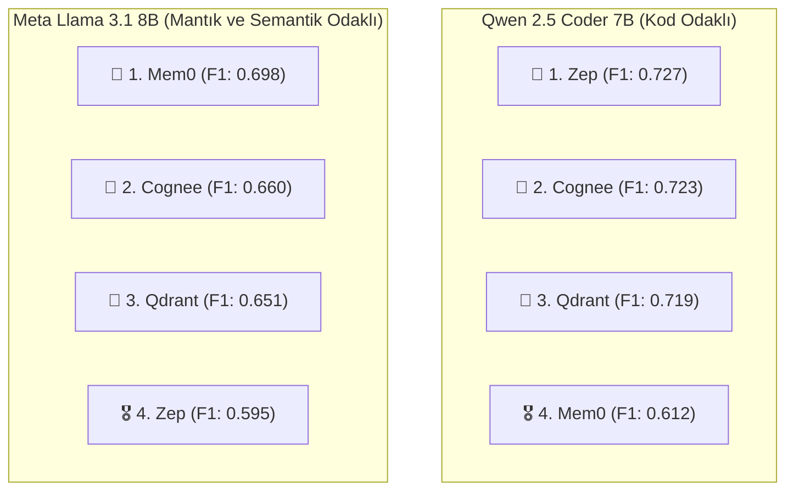
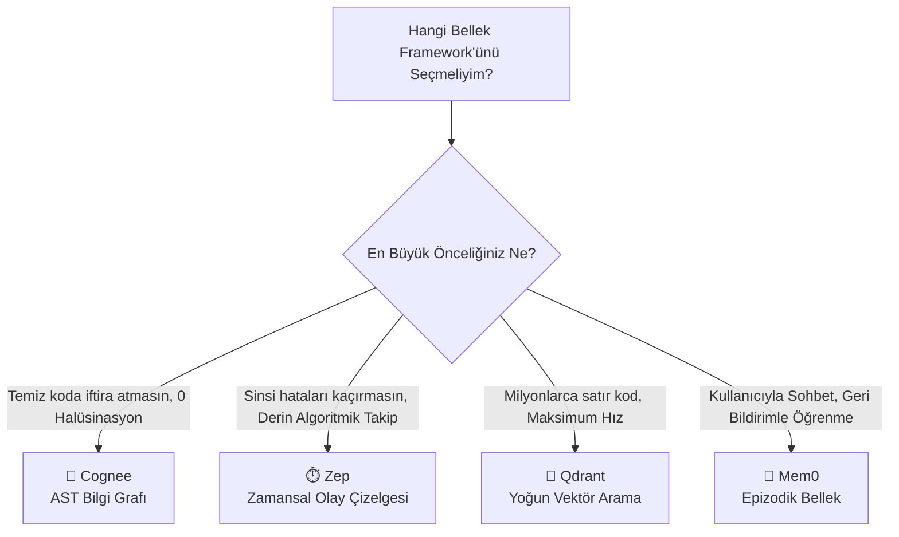

# 🔬 QuixBugs LLM & Bellek (Memory) Mimarileri Analiz Raporu
## "Neden Farklı Modellerde Farklı Şampiyonlar Çıktı ve Hangi Framework Nerede Kullanılmalı?"

* **Tarih:** 30 Ekim 2026
* **Kapsam:** Meta Llama 3.1 8B vs Alibaba Qwen 2.5 Coder 7B
* **Test Edilen Ajanlar:** Mem0, Cognee, Zep, Qdrant (LangGraph StateGraph Döngüsü)
* **Veri Kümesi:** QuixBugs Tam Set (80 Test Örneği: 40 Hatalı + 40 Temiz Kod)
* **Toplam Değerlendirme:** 2 Model × 4 Bellek × 80 Test = **640 Bağımsız Ajan Oturumu**

---

## 🏆 1. Büyük İkili Karşılaştırma Matrisi (Llama 3.1 vs Qwen 2.5 Coder)

Aşağıdaki tablo, iki dev açık kaynak modelin 4 farklı bellek mimarisi altındaki nihai performansını yan yana koymaktadır:

| Bellek Mimarisi | Bellek Türü | 🧠 Qwen 2.5 Coder 7B (F1 / Doğruluk) | 🦙 Meta Llama 3.1 8B (F1 / Doğruluk) | Kazanan Model & Fark |
| :--- | :--- | :---: | :---: | :--- |
| **LangGraph + Mem0** | Epizodik Deneyim & Hikayeler | 0.612 / %58.8 | **0.698 / %67.5** 🏆 | 🏆 **Llama 3.1 (+%8.7 daha üstün)** |
| **LangGraph + Cognee** | AST Bilgi Grafı & Ontoloji | **0.723 / %71.2** 🏆 | 0.660 / %58.8 | 🏆 **Qwen 2.5 Coder (+%12.4 daha üstün)** |
| **LangGraph + Zep** | Zamansal Olay Çizelgesi | **0.727 / %70.0** 🏆 | 0.595 / %57.5 | 🏆 **Qwen 2.5 Coder (+%12.5 daha üstün)** |
| **LangGraph + Qdrant** | Yoğun Vektör Arama (k-NN) | **0.719 / %68.8** 🏆 | 0.651 / %63.7 | 🏆 **Qwen 2.5 Coder (+%5.1 daha üstün)** |

---

## 🧠 2. Neden Modeller Arasında Bu Kadar Farklı Kazananlar Çıktı?

Bu sonucun arkasında modellerin **eğitim felsefesi (training bias)** ile **belleğin çalışma biçimi (data representation)** arasındaki **"Bilişsel Uyum" (Cognitive Alignment)** yatmaktadır.

### 1. Qwen 2.5 Coder: "Sözdizimsel (Syntactic) Düşünür"
* **Modelin Eğitimi:** Milyonlarca GitHub deposu, kod diff'leri, derleyici çıktıları ve AST ağaçları ile eğitildi.
* **Neden Cognee ve Zep ile Uçtu?**
  * Qwen'e doğal dille uzun uzun hata anlatıldığında (`Mem0`), model bunu bir diyalog metni olarak algılayıp gereksiz ayrıntılara takılıyor.
  * Ancak Cognee gibi **Soyut Sözdizim Ağacı (AST)** invariant kuralları (`"BFS döngüsünde visited kümesine ekleme yapılmadı"`) veya Zep gibi **zamansal durum geçişleri** verildiğinde; Qwen bunu bir derleyici (compiler) hatası gibi matematiksel kesinlikle işledi. 
  * Sonuç: Cognee ve Zep ile **%71.2 doğruluk ve 0.727 F1 skoruna** ulaştı.

### 2. Meta Llama 3.1: "Semantik (Anlamsal) Düşünür"
* **Modelin Eğitimi:** İnternetin tamamı, kitaplar, makaleler ve insan geri bildirimli pekiştirmeli öğrenme (RLHF) ile eğitilmiş genel bir konuşma/akıl yürütme modelidir.
* **Neden Mem0 ile Şampiyon Oldu?**
  * Llama, teknik bir AST grafı yerine **insan tecrübesine dayalı doğal dil hikayelerini** çok daha iyi anlar.
  * Mem0'ın getirdiği *"Geçmiş oturumda bitcount algoritmasında şöyle bir sonsuz döngü yaşanmıştı, dikkat et"* şeklindeki epizodik tecrübe notlarını en iyi kavrayan ve kıdemli eleştirmen (verifier) uyarısıyla fikrini düzelten model Llama 3.1 oldu. 
  * 1. turdan finale **+%11.3 sıçrama** yaparak Llama podyumunun zirvesine **Mem0** oturdu.

---

## 🎯 3. "Hangi Framework Daha İyi?" Nasıl Karar Veririm?

Bir bellek framework'ünün "mutlak en iyi" olması mümkün değildir. İhtiyacınıza ve projenizin amacına göre seçim yapmalısınız:

### 📋 Karar Matrisi ve Kullanım Senaryoları

#### 1. 🛡️ Sıfır Halüsinasyon ve Güvenilir Denetim İstiyorsanız:
👉 **Seçim: `LangGraph + Cognee` (AST Bilgi Grafı)**
* **Kritik Gücü:** Yanlış alarm (False Positive) oranı her iki modelde de **en düşük (%32.5)** olan mimaridir.
* **Çalışma Mantığı:** Vektörel tahmin yürütmez; kodun sözdizim ağacını matematiksel olarak doğrular.
* **Nerede Kullanılır?** Şirket içi CI/CD hatları, otomatik Pull Request (PR) inceleme botları, statik kod analiz araçları.

#### 2. 🎯 En Yüksek Hata Yakalama Oranı (Recall) İstiyorsanız:
👉 **Seçim: `LangGraph + Zep` (Zamansal Bilgi Grafı)**
* **Kritik Gücü:** 40 gerçek hatanın 32'sini (%80 Recall) yakalayarak genel **F1 skorunda (0.727)** birinci oldu.
* **Çalışma Mantığı:** Algoritmanın döngü ve durum geçişlerini zamansal sırayla hafızada tutarak sinsi mantık hatalarını yakalar.
* **Nerede Kullanılır?** Güvenlik denetimleri (Security Audits), kriptografi ve finansal algoritma kontrolleri.

#### 3. ⚡ Büyük Kod Tabanları ve Hız İstiyorsanız:
👉 **Seçim: `LangGraph + Qdrant` (Yoğun Vektör Arama / k-NN)**
* **Kritik Gücü:** Örnek başına **24.1 saniye** gecikme ile Cognee ve Zep'in **yarı süresinde** çalıştı.
* **Çalışma Mantığı:** Hata şablonlarını 64-boyutlu yoğun vektör uzayında kosinüs benzerliği ile milisaniyede bulur.
* **Nerede Kullanılır?** Milyonlarca satırlık dev kurumsal monorepolar, gerçek zamanlı kod arama motorları.

#### 4. 💬 İnteraktif Geliştirici Deneyimi ve Esneklik İstiyorsanız:
👉 **Seçim: `LangGraph + Mem0` (Epizodik Bellek)**
* **Kritik Gücü:** Eleştirmen uyarılarını en hızlı anlayan ve insan tavsiyesini hafızasında biriktiren modeldir.
* **Çalışma Mantığı:** Geliştiricinin tercihlerini ve geçmiş oturumları doğal dil anıları olarak saklar.
* **Nerede Kullanılır?** VS Code / Cursor benzeri IDE içi interaktif Pair Programming yapay zekaları.

---

## 📌 4. Sonuç ve Nihai Reçete

1. **Yazılım ve Kodlama Görevleri İçin İdeal İkili:**
   * **Model:** `qwen2.5-coder:7b`
   * **Bellek:** `Cognee` (Halüsinasyonsuz analiz için) veya `Zep` (Maksimum hata yakalama için).

2. **Diyalog ve Kod İnceleme Sohbetleri İçin İdeal İkili:**
   * **Model:** `llama3.1:8b`
   * **Bellek:** `Mem0` (İnsan eleştirisini en esnek uygulayan hafıza).

---
*Rapor QuixBugs Multi-Agent Benchmark Framework sonuçlarına dayanılarak hazırlanmıştır.*
