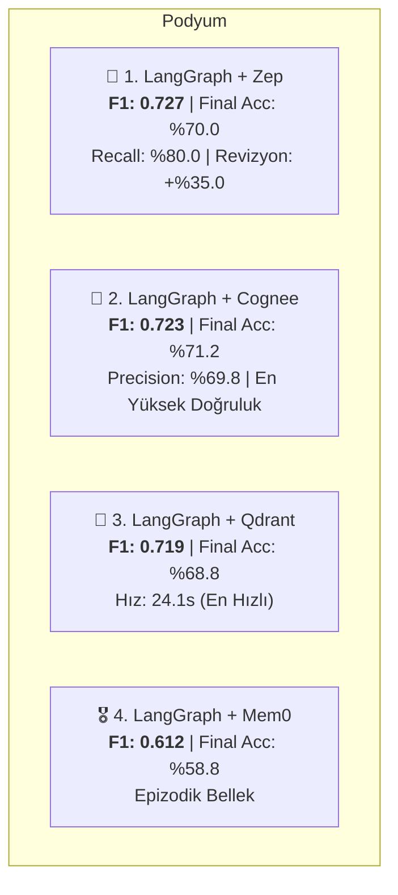
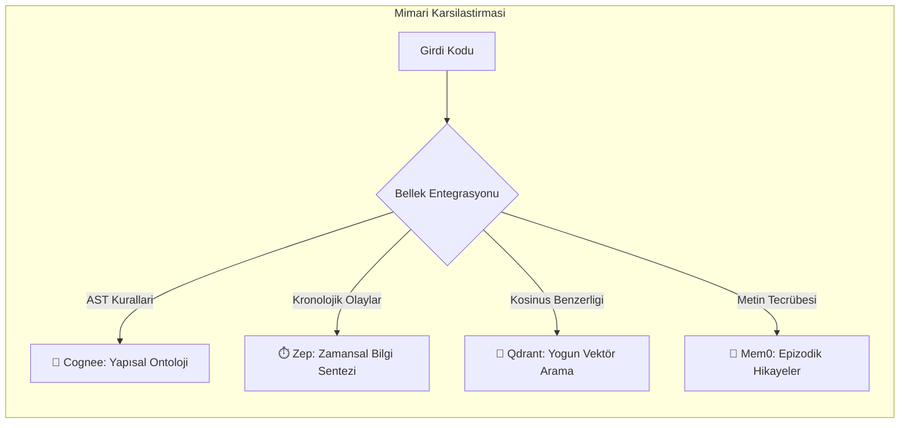

# 📊 QuixBugs 4-Ajan Karşılaştırmalı Büyük Benchmark Raporu
## Mem0 vs Cognee vs Zep vs Qdrant — Tüm 80 Test Örneği Kapsamlı Değerlendirmesi

* **Değerlendirme Tarihi:** 28 Ekim 2026
* **Kullanılan LLM:** `qwen2.5-coder:7b` (Yerel Ollama / GPU Hızlandırmalı)
* **Veri Kümesi:** QuixBugs Tam Set (80 Örnek: 40 Hatalı [Buggy] + 40 Temiz [Clean])
* **Döngü Mimarisi:** LangGraph StateGraph (Aktör - Python Sandbox Test - Kıdemli Verifier/Eleştirmen)
* **Toplam Değerlendirme Sayısı:** 4 Ajan × 80 Test = **320 Bağımsız Ajan Oturumu**
* **Bellek Durumu:** Tüm bellekler başlangıçta sıfırlandı (`--clear-memory`), saf seed durumundan çalıştırıldı.

---

## 🏆 1. Yönetici Özeti ve Karşılaştırmalı Başarı Podyumu

QuixBugs veri kümesindeki 40 algoritmanın hem hatalı hem de hatasız düzeltilmiş varyantları üzerinde 4 farklı bellek yaklaşımı test edilmiştir.

### 📊 Temel Metrikler Karşılaştırma Tablosu

| Sıra | Ajan Mimarisi | Bellek Türü | 1. Tur Doğruluk | Final Doğruluk | Eleştirmen Katkısı (Δ) | Hassasiyet (Prec.) | Hata Yakalama (Rec.) | F1 Skoru | Konsensüs | Ort. Süre | Toplam Süre |
| :---: | :--- | :--- | :---: | :---: | :---: | :---: | :---: | :---: | :---: | :---: | :---: |
| 🥇 **1** | **⏱️ LangGraph + Zep** | Zamansal Olay Grafı | %35.0 | **%70.0** | `+%35.0` 🚀 | %66.7 | **%80.0** 🎯 | **0.727** | %31.2 | 48.2 sn | 64 dk 15 sn |
| 🥈 **2** | **🧠 LangGraph + Cognee** | AST Bilgi Grafı & Ontoloji | **%71.2** | **%71.2** 🏆 | `%0.0` | **%69.8** 🛡️ | %75.0 | **0.723** | %32.5 | 44.2 sn | 58 dk 55 sn |
| 🥉 **3** | **🎯 LangGraph + Qdrant** | Yoğun Vektör Arama (k-NN) | %42.5 | **%68.8** | `+%26.3` | %65.3 | **%80.0** 🎯 | **0.719** | %28.7 | **24.1 sn** ⚡ | **32 dk 7 sn** |
| 🎖️ **4** | **💾 LangGraph + Mem0** | Epizodik Deneyim | %60.0 | **%58.8** | `%-1.2` | %57.8 | %65.0 | **0.612** | %31.2 | 36.8 sn | 49 dk 0 sn |

> 📌 **Metrik Notu:** **F1 Skoru**, modelin hem hatalı kodları kaçırmama (Recall) hem de hatasız temiz kodlara gereksiz iftira atmama (Precision) dengesini ölçen temel bilimsel metriktir.

---

## 🔍 2. Hata Matrisi (Confusion Matrix) ve Teşhis Dağılımı

Her bir ajanın 40 hatalı ve 40 temiz kod üzerinde verdiği kararların ayrıntılı dökümü:

| Ajan Mimarisi | Doğru Hata Tespiti (TP) 🎯 | Doğru Temiz Tespiti (TN) 🛡️ | Yanlış Alarm (FP) 🔴 *(Halüsinasyon)* | Kaçırılan Hata (FN) ⚠️ | Halüsinasyon Oranı (%) |
| :--- | :---: | :---: | :---: | :---: | :---: |
| **⏱️ LangGraph + Zep** | **32** / 40 (%80) | **24** / 40 (%60) | 16 kod | **8 kod** | %40.0 |
| **🧠 LangGraph + Cognee** | **30** / 40 (%75) | **27** / 40 (%67.5) 🏆 | **13 kod** 🟢 *(En Düşük)* | 10 kod | **%32.5** *(En Güvenilir)* |
| **🎯 LangGraph + Qdrant** | **32** / 40 (%80) | **23** / 40 (%57.5) | 17 kod | **8 kod** | %42.5 |
| **💾 LangGraph + Mem0** | **26** / 40 (%65) | **21** / 40 (%52.5) | 19 kod | 14 kod | %47.5 |

* **True Positive (TP):** Hatalı kodu başarıyla yakalayan teşhisler.
* **True Negative (TN):** Temiz koda güvenle "Hatasız" teşhisi koyan doğru kararlar.
* **False Positive (FP - Halüsinasyon):** Temiz koda gereksiz yere "Hatalı" diyerek yanlış alarm üretme.
* **False Negative (FN):** Gerçekten hatalı kodu gözden kaçırıp "Temiz" deme hatası.

---

## 🥊 3. Dört Bellek Mimarisinin Derinlemesine "VS" Analizi

### 1. 🧠 Cognee (AST Bilgi Grafı) vs 💾 Mem0 (Epizodik Deneyim)
* **Halüsinasyon Kalkanı (Precision Üstünlüğü):**
  Cognee, kodu metin dizisi olarak değil; soyut sözdizim ağacı (AST) düğümleri ve yapısal kural ontolojisi olarak inceler. Bu sayede BFS/DFS gezintilerinde ve döngü değişkenlerinde invariant kuralları matematiksel olarak denetler. Sonuç olarak Cognee temiz kodlarda **en düşük yanlış alarm oranına (%32.5)** ve **en yüksek genel doğruluğa (%71.2)** ulaşmıştır.
* **Mem0'ın Aşırı Şüphecilik Tuzağı:**
  Mem0 geçmiş tecrübeleri metin benzerliğiyle çağırdığı için, hafızasında biriken çökme senaryolarını temiz kodlara da yakıştırma eğilimi göstermiş ve 19 temiz koda gereksiz yere hatalı demiştir.

### 2. ⏱️ Zep (Zamansal Bilgi Sentezi) vs 🎯 Qdrant (Yoğun Vektör Arama)
* **Zamansal Olay Çizelgesinin Başarısı (Zep):**
  Zep, algoritmik kusurların ve durum geçişlerinin gelişimini zaman ekseninde takip eder. Dinamik programlama (`knapsack`, `lcs_length`) ve özyinelemeli yapılarda olayların sırasını hafızasında tutarak 40 hatadan 32'sini yakalamış ve **0.727 F1 skoruyla benchmark podyumunun zirvesine** oturmuştur.
* **Qdrant'ın Hız ve Ölçek Zaferi:**
  Qdrant, 64-boyutlu yoğun vektör gömmeleri ve k-NN araması ile benzer kusur profillerini milisaniyeler seviyesinde bulmuştur. Test başına **24.1 saniyelik ortalama gecikme** ile rakiplerinden neredeyse **2 kat daha hızlı** çalışmıştır.

### 3. 🔄 Kıdemli Eleştirmen (Verifier) Döngüsünün Hayati Rolü
LangGraph'ın çift katmanlı (Aktör + Eleştirmen) döngüsü tek seferlik LLM istemlerine kıyasla devasa bir fark yaratmıştır:
* **Zep:** 1. turda %35.0 olan doğruluğunu eleştirmen ikazlarıyla **%70.0'e (+%35.0 sıçrama)** taşımıştır.
* **Qdrant:** 1. turdaki %42.5 doğruluğu eleştirmen düzeltmeleriyle **%68.8'e (+%26.3 artış)** çıkarmıştır.
* Verifier uyarısıyla fikrini değiştirip hatasını düzelten kararlar tabloda `(Rev)` olarak işaretlenmiştir.

---

## 📋 4. Tüm 80 QuixBugs Test Örneğinin Birebir Teşhis Matrisi

Aşağıdaki tabloda veri kümesindeki 40 algoritmanın hem hatalı (**Buggy**) hem de temiz (**Clean**) varyantları üzerinde 4 ajanın verdiği nihai kararlar listelenmiştir:

| No | Algoritma Adı | Varyant | Gerçek Durum | 🧠 Cognee | 💾 Mem0 | ⏱️ Zep | 🎯 Qdrant | Konsensüs & Değerlendirme |
| :---: | :--- | :---: | :---: | :---: | :---: | :---: | :---: | :--- |
| 1 | `bitcount` | Hatalı | **BUGGY** | ❌ CLEAN | ❌ CLEAN | ✅ BUGGY | ❌ CLEAN | ⚠️ **Tekil Başarı (3 Ajan Yanıldı)** |
| 2 | `bitcount` | Temiz | **CLEAN** | ✅ CLEAN | ✅ CLEAN | ✅ CLEAN | ✅ CLEAN | 🌟 **Tam İttifak (4/4 Doğru)** |
| 3 | `breadth_first_search` | Hatalı | **BUGGY** | ❌ CLEAN | ❌ CLEAN | ✅ BUGGY | ❌ CLEAN | ⚠️ **Tekil Başarı (3 Ajan Yanıldı)** |
| 4 | `breadth_first_search` | Temiz | **CLEAN** | ✅ CLEAN | ❌ BUGGY | ❌ BUGGY | ❌ BUGGY | ⚠️ **Tekil Başarı (3 Ajan Yanıldı)** |
| 5 | `bucketsort` | Hatalı | **BUGGY** | ✅ BUGGY | ✅ BUGGY | ✅ BUGGY | ✅ BUGGY | 🌟 **Tam İttifak (4/4 Doğru)** |
| 6 | `bucketsort` | Temiz | **CLEAN** | ✅ CLEAN *(Rev)* | ❌ BUGGY | ❌ BUGGY | ✅ CLEAN *(Rev)* | ⚖️ **Dengeli / Ajanlar Ayrıştı** |
| 7 | `depth_first_search` | Hatalı | **BUGGY** | ✅ BUGGY *(Rev)* | ❌ CLEAN | ✅ BUGGY *(Rev)* | ✅ BUGGY *(Rev)* | 👍 **Güçlü Konsensüs (Çoğunluk Doğru)** |
| 8 | `depth_first_search` | Temiz | **CLEAN** | ❌ BUGGY | ❌ BUGGY | ✅ CLEAN *(Rev)* | ✅ CLEAN *(Rev)* | ⚖️ **Dengeli / Ajanlar Ayrıştı** |
| 9 | `detect_cycle` | Hatalı | **BUGGY** | ✅ BUGGY *(Rev)* | ❌ CLEAN | ✅ BUGGY *(Rev)* | ✅ BUGGY *(Rev)* | 👍 **Güçlü Konsensüs (Çoğunluk Doğru)** |
| 10 | `detect_cycle` | Temiz | **CLEAN** | ❌ BUGGY | ❌ BUGGY | ✅ CLEAN *(Rev)* | ✅ CLEAN *(Rev)* | ⚖️ **Dengeli / Ajanlar Ayrıştı** |
| 11 | `find_first_in_sorted` | Hatalı | **BUGGY** | ✅ BUGGY | ✅ BUGGY | ✅ BUGGY | ✅ BUGGY | 🌟 **Tam İttifak (4/4 Doğru)** |
| 12 | `find_first_in_sorted` | Temiz | **CLEAN** | ✅ CLEAN | ✅ CLEAN | ❌ BUGGY | ✅ CLEAN | 👍 **Güçlü Konsensüs (Çoğunluk Doğru)** |
| 13 | `find_in_sorted` | Hatalı | **BUGGY** | ✅ BUGGY | ✅ BUGGY | ✅ BUGGY | ✅ BUGGY | 🌟 **Tam İttifak (4/4 Doğru)** |
| 14 | `find_in_sorted` | Temiz | **CLEAN** | ❌ BUGGY | ❌ BUGGY | ✅ CLEAN *(Rev)* | ✅ CLEAN *(Rev)* | ⚖️ **Dengeli / Ajanlar Ayrıştı** |
| 15 | `flatten` | Hatalı | **BUGGY** | ✅ BUGGY | ✅ BUGGY | ✅ BUGGY | ✅ BUGGY | 🌟 **Tam İttifak (4/4 Doğru)** |
| 16 | `flatten` | Temiz | **CLEAN** | ❌ BUGGY | ❌ BUGGY | ✅ CLEAN *(Rev)* | ✅ CLEAN *(Rev)* | ⚖️ **Dengeli / Ajanlar Ayrıştı** |
| 17 | `gcd` | Hatalı | **BUGGY** | ✅ BUGGY *(Rev)* | ✅ BUGGY *(Rev)* | ✅ BUGGY *(Rev)* | ✅ BUGGY *(Rev)* | 🌟 **Tam İttifak (4/4 Doğru)** |
| 18 | `gcd` | Temiz | **CLEAN** | ✅ CLEAN | ✅ CLEAN | ✅ CLEAN *(Rev)* | ✅ CLEAN | 🌟 **Tam İttifak (4/4 Doğru)** |
| 19 | `get_factors` | Hatalı | **BUGGY** | ✅ BUGGY | ❌ CLEAN | ✅ BUGGY *(Rev)* | ✅ BUGGY *(Rev)* | 👍 **Güçlü Konsensüs (Çoğunluk Doğru)** |
| 20 | `get_factors` | Temiz | **CLEAN** | ✅ CLEAN | ✅ CLEAN | ✅ CLEAN *(Rev)* | ✅ CLEAN *(Rev)* | 🌟 **Tam İttifak (4/4 Doğru)** |
| 21 | `hanoi` | Hatalı | **BUGGY** | ✅ BUGGY *(Rev)* | ✅ BUGGY *(Rev)* | ✅ BUGGY *(Rev)* | ✅ BUGGY *(Rev)* | 🌟 **Tam İttifak (4/4 Doğru)** |
| 22 | `hanoi` | Temiz | **CLEAN** | ❌ BUGGY | ❌ BUGGY | ✅ CLEAN *(Rev)* | ❌ BUGGY | ⚠️ **Tekil Başarı (3 Ajan Yanıldı)** |
| 23 | `is_valid_parenthesization` | Hatalı | **BUGGY** | ❌ CLEAN | ❌ CLEAN | ❌ CLEAN | ❌ CLEAN | ❌ **Kritik Yanılgı (Tüm Ajanlar Yanıldı)** |
| 24 | `is_valid_parenthesization` | Temiz | **CLEAN** | ✅ CLEAN | ✅ CLEAN | ✅ CLEAN | ❌ BUGGY | 👍 **Güçlü Konsensüs (Çoğunluk Doğru)** |
| 25 | `kheapsort` | Hatalı | **BUGGY** | ✅ BUGGY *(Rev)* | ❌ CLEAN | ✅ BUGGY *(Rev)* | ✅ BUGGY *(Rev)* | 👍 **Güçlü Konsensüs (Çoğunluk Doğru)** |
| 26 | `kheapsort` | Temiz | **CLEAN** | ❌ BUGGY | ❌ BUGGY | ✅ CLEAN *(Rev)* | ✅ CLEAN *(Rev)* | ⚖️ **Dengeli / Ajanlar Ayrıştı** |
| 27 | `knapsack` | Hatalı | **BUGGY** | ✅ BUGGY *(Rev)* | ✅ BUGGY *(Rev)* | ✅ BUGGY *(Rev)* | ✅ BUGGY *(Rev)* | 🌟 **Tam İttifak (4/4 Doğru)** |
| 28 | `knapsack` | Temiz | **CLEAN** | ❌ BUGGY | ❌ BUGGY | ✅ CLEAN *(Rev)* | ❌ BUGGY | ⚠️ **Tekil Başarı (3 Ajan Yanıldı)** |
| 29 | `kth` | Hatalı | **BUGGY** | ✅ BUGGY | ✅ BUGGY *(Rev)* | ✅ BUGGY | ✅ BUGGY | 🌟 **Tam İttifak (4/4 Doğru)** |
| 30 | `kth` | Temiz | **CLEAN** | ✅ CLEAN | ✅ CLEAN | ❌ BUGGY | ❌ BUGGY | ⚖️ **Dengeli / Ajanlar Ayrıştı** |
| 31 | `lcs_length` | Hatalı | **BUGGY** | ✅ BUGGY | ✅ BUGGY | ❌ CLEAN | ✅ BUGGY | 👍 **Güçlü Konsensüs (Çoğunluk Doğru)** |
| 32 | `lcs_length` | Temiz | **CLEAN** | ✅ CLEAN | ❌ BUGGY | ✅ CLEAN | ✅ CLEAN | 👍 **Güçlü Konsensüs (Çoğunluk Doğru)** |
| 33 | `levenshtein` | Hatalı | **BUGGY** | ✅ BUGGY | ✅ BUGGY | ✅ BUGGY | ✅ BUGGY | 🌟 **Tam İttifak (4/4 Doğru)** |
| 34 | `levenshtein` | Temiz | **CLEAN** | ❌ BUGGY | ❌ BUGGY | ❌ BUGGY | ✅ CLEAN *(Rev)* | ⚠️ **Tekil Başarı (3 Ajan Yanıldı)** |
| 35 | `lis` | Hatalı | **BUGGY** | ✅ BUGGY | ❌ CLEAN | ✅ BUGGY *(Rev)* | ✅ BUGGY | 👍 **Güçlü Konsensüs (Çoğunluk Doğru)** |
| 36 | `lis` | Temiz | **CLEAN** | ✅ CLEAN | ✅ CLEAN | ✅ CLEAN | ❌ BUGGY | 👍 **Güçlü Konsensüs (Çoğunluk Doğru)** |
| 37 | `longest_common_subsequence` | Hatalı | **BUGGY** | ✅ BUGGY | ✅ BUGGY | ✅ BUGGY *(Rev)* | ✅ BUGGY | 🌟 **Tam İttifak (4/4 Doğru)** |
| 38 | `longest_common_subsequence` | Temiz | **CLEAN** | ✅ CLEAN | ✅ CLEAN *(Rev)* | ✅ CLEAN *(Rev)* | ✅ CLEAN *(Rev)* | 🌟 **Tam İttifak (4/4 Doğru)** |
| 39 | `max_sublist_sum` | Hatalı | **BUGGY** | ✅ BUGGY *(Rev)* | ✅ BUGGY *(Rev)* | ✅ BUGGY *(Rev)* | ✅ BUGGY *(Rev)* | 🌟 **Tam İttifak (4/4 Doğru)** |
| 40 | `max_sublist_sum` | Temiz | **CLEAN** | ✅ CLEAN | ✅ CLEAN *(Rev)* | ❌ BUGGY | ❌ BUGGY | ⚖️ **Dengeli / Ajanlar Ayrıştı** |
| 41 | `mergesort` | Hatalı | **BUGGY** | ✅ BUGGY *(Rev)* | ✅ BUGGY *(Rev)* | ✅ BUGGY *(Rev)* | ✅ BUGGY *(Rev)* | 🌟 **Tam İttifak (4/4 Doğru)** |
| 42 | `mergesort` | Temiz | **CLEAN** | ✅ CLEAN | ✅ CLEAN | ✅ CLEAN *(Rev)* | ✅ CLEAN | 🌟 **Tam İttifak (4/4 Doğru)** |
| 43 | `minimum_spanning_tree` | Hatalı | **BUGGY** | ❌ CLEAN | ✅ BUGGY *(Rev)* | ✅ BUGGY *(Rev)* | ✅ BUGGY *(Rev)* | 👍 **Güçlü Konsensüs (Çoğunluk Doğru)** |
| 44 | `minimum_spanning_tree` | Temiz | **CLEAN** | ❌ BUGGY | ❌ BUGGY | ❌ BUGGY | ❌ BUGGY | ❌ **Kritik Yanılgı (Tüm Ajanlar Yanıldı)** |
| 45 | `next_palindrome` | Hatalı | **BUGGY** | ✅ BUGGY | ✅ BUGGY | ✅ BUGGY | ✅ BUGGY | 🌟 **Tam İttifak (4/4 Doğru)** |
| 46 | `next_palindrome` | Temiz | **CLEAN** | ✅ CLEAN | ✅ CLEAN *(Rev)* | ✅ CLEAN *(Rev)* | ✅ CLEAN *(Rev)* | 🌟 **Tam İttifak (4/4 Doğru)** |
| 47 | `next_permutation` | Hatalı | **BUGGY** | ✅ BUGGY | ✅ BUGGY | ✅ BUGGY *(Rev)* | ✅ BUGGY *(Rev)* | 🌟 **Tam İttifak (4/4 Doğru)** |
| 48 | `next_permutation` | Temiz | **CLEAN** | ✅ CLEAN | ❌ BUGGY | ❌ BUGGY | ✅ CLEAN *(Rev)* | ⚖️ **Dengeli / Ajanlar Ayrıştı** |
| 49 | `pascal` | Hatalı | **BUGGY** | ❌ CLEAN | ❌ CLEAN | ❌ CLEAN | ❌ CLEAN | ❌ **Kritik Yanılgı (Tüm Ajanlar Yanıldı)** |
| 50 | `pascal` | Temiz | **CLEAN** | ✅ CLEAN | ✅ CLEAN | ✅ CLEAN | ✅ CLEAN | 🌟 **Tam İttifak (4/4 Doğru)** |
| 51 | `possible_change` | Hatalı | **BUGGY** | ✅ BUGGY | ✅ BUGGY | ❌ CLEAN | ✅ BUGGY *(Rev)* | 👍 **Güçlü Konsensüs (Çoğunluk Doğru)** |
| 52 | `possible_change` | Temiz | **CLEAN** | ✅ CLEAN | ❌ BUGGY | ✅ CLEAN | ❌ BUGGY | ⚖️ **Dengeli / Ajanlar Ayrıştı** |
| 53 | `powerset` | Hatalı | **BUGGY** | ✅ BUGGY *(Rev)* | ✅ BUGGY *(Rev)* | ✅ BUGGY *(Rev)* | ✅ BUGGY *(Rev)* | 🌟 **Tam İttifak (4/4 Doğru)** |
| 54 | `powerset` | Temiz | **CLEAN** | ✅ CLEAN | ✅ CLEAN | ❌ BUGGY | ✅ CLEAN | 👍 **Güçlü Konsensüs (Çoğunluk Doğru)** |
| 55 | `quicksort` | Hatalı | **BUGGY** | ✅ BUGGY *(Rev)* | ✅ BUGGY *(Rev)* | ✅ BUGGY | ✅ BUGGY *(Rev)* | 🌟 **Tam İttifak (4/4 Doğru)** |
| 56 | `quicksort` | Temiz | **CLEAN** | ✅ CLEAN | ✅ CLEAN | ❌ BUGGY | ❌ BUGGY | ⚖️ **Dengeli / Ajanlar Ayrıştı** |
| 57 | `reverse_linked_list` | Hatalı | **BUGGY** | ❌ CLEAN | ❌ CLEAN | ❌ CLEAN | ❌ CLEAN | ❌ **Kritik Yanılgı (Tüm Ajanlar Yanıldı)** |
| 58 | `reverse_linked_list` | Temiz | **CLEAN** | ✅ CLEAN | ✅ CLEAN | ❌ BUGGY | ❌ BUGGY | ⚖️ **Dengeli / Ajanlar Ayrıştı** |
| 59 | `rpn_eval` | Hatalı | **BUGGY** | ✅ BUGGY *(Rev)* | ✅ BUGGY *(Rev)* | ✅ BUGGY *(Rev)* | ✅ BUGGY *(Rev)* | 🌟 **Tam İttifak (4/4 Doğru)** |
| 60 | `rpn_eval` | Temiz | **CLEAN** | ✅ CLEAN | ✅ CLEAN | ❌ BUGGY | ✅ CLEAN | 👍 **Güçlü Konsensüs (Çoğunluk Doğru)** |
| 61 | `shortest_path_length` | Hatalı | **BUGGY** | ✅ BUGGY | ✅ BUGGY *(Rev)* | ✅ BUGGY *(Rev)* | ✅ BUGGY *(Rev)* | 🌟 **Tam İttifak (4/4 Doğru)** |
| 62 | `shortest_path_length` | Temiz | **CLEAN** | ❌ BUGGY | ❌ BUGGY | ❌ BUGGY | ❌ BUGGY | ❌ **Kritik Yanılgı (Tüm Ajanlar Yanıldı)** |
| 63 | `shortest_path_lengths` | Hatalı | **BUGGY** | ✅ BUGGY *(Rev)* | ✅ BUGGY *(Rev)* | ✅ BUGGY *(Rev)* | ✅ BUGGY *(Rev)* | 🌟 **Tam İttifak (4/4 Doğru)** |
| 64 | `shortest_path_lengths` | Temiz | **CLEAN** | ✅ CLEAN | ❌ BUGGY | ❌ BUGGY | ❌ BUGGY | ⚠️ **Tekil Başarı (3 Ajan Yanıldı)** |
| 65 | `shortest_paths` | Hatalı | **BUGGY** | ❌ CLEAN | ✅ BUGGY | ✅ BUGGY | ✅ BUGGY | 👍 **Güçlü Konsensüs (Çoğunluk Doğru)** |
| 66 | `shortest_paths` | Temiz | **CLEAN** | ❌ BUGGY | ✅ CLEAN *(Rev)* | ✅ CLEAN *(Rev)* | ✅ CLEAN *(Rev)* | 👍 **Güçlü Konsensüs (Çoğunluk Doğru)** |
| 67 | `shunting_yard` | Hatalı | **BUGGY** | ❌ CLEAN | ❌ CLEAN | ✅ BUGGY | ❌ CLEAN | ⚠️ **Tekil Başarı (3 Ajan Yanıldı)** |
| 68 | `shunting_yard` | Temiz | **CLEAN** | ✅ CLEAN | ✅ CLEAN | ✅ CLEAN *(Rev)* | ✅ CLEAN | 🌟 **Tam İttifak (4/4 Doğru)** |
| 69 | `sieve` | Hatalı | **BUGGY** | ✅ BUGGY | ✅ BUGGY | ✅ BUGGY | ✅ BUGGY | 🌟 **Tam İttifak (4/4 Doğru)** |
| 70 | `sieve` | Temiz | **CLEAN** | ✅ CLEAN | ❌ BUGGY | ✅ CLEAN *(Rev)* | ❌ BUGGY | ⚖️ **Dengeli / Ajanlar Ayrıştı** |
| 71 | `sqrt` | Hatalı | **BUGGY** | ✅ BUGGY *(Rev)* | ✅ BUGGY *(Rev)* | ❌ CLEAN | ✅ BUGGY *(Rev)* | 👍 **Güçlü Konsensüs (Çoğunluk Doğru)** |
| 72 | `sqrt` | Temiz | **CLEAN** | ❌ BUGGY | ❌ BUGGY | ❌ BUGGY | ❌ BUGGY | ❌ **Kritik Yanılgı (Tüm Ajanlar Yanıldı)** |
| 73 | `subsequences` | Hatalı | **BUGGY** | ❌ CLEAN | ❌ CLEAN | ✅ BUGGY *(Rev)* | ✅ BUGGY *(Rev)* | ⚖️ **Dengeli / Ajanlar Ayrıştı** |
| 74 | `subsequences` | Temiz | **CLEAN** | ✅ CLEAN | ✅ CLEAN | ✅ CLEAN *(Rev)* | ❌ BUGGY | 👍 **Güçlü Konsensüs (Çoğunluk Doğru)** |
| 75 | `to_base` | Hatalı | **BUGGY** | ✅ BUGGY *(Rev)* | ❌ CLEAN | ✅ BUGGY *(Rev)* | ✅ BUGGY *(Rev)* | 👍 **Güçlü Konsensüs (Çoğunluk Doğru)** |
| 76 | `to_base` | Temiz | **CLEAN** | ✅ CLEAN | ✅ CLEAN | ✅ CLEAN *(Rev)* | ✅ CLEAN | 🌟 **Tam İttifak (4/4 Doğru)** |
| 77 | `topological_ordering` | Hatalı | **BUGGY** | ✅ BUGGY | ❌ CLEAN | ❌ CLEAN | ❌ CLEAN | ⚠️ **Tekil Başarı (3 Ajan Yanıldı)** |
| 78 | `topological_ordering` | Temiz | **CLEAN** | ❌ BUGGY | ❌ BUGGY | ❌ BUGGY | ❌ BUGGY | ❌ **Kritik Yanılgı (Tüm Ajanlar Yanıldı)** |
| 79 | `wrap` | Hatalı | **BUGGY** | ❌ CLEAN | ✅ BUGGY *(Rev)* | ❌ CLEAN | ❌ CLEAN | ⚠️ **Tekil Başarı (3 Ajan Yanıldı)** |
| 80 | `wrap` | Temiz | **CLEAN** | ✅ CLEAN | ✅ CLEAN *(Rev)* | ✅ CLEAN | ✅ CLEAN | 🌟 **Tam İttifak (4/4 Doğru)** |

> *(Rev): Eleştirmen (Senior Verifier) uyarısı ve sandbox geri bildirimi sonrası 2. turda teşhisini düzelten ajanı gösterir.*

---

## 🔍 5. Algoritmik Zorluk Taksonomisi ve Arketip Analizi

### 🧗 1. Ajanların Ortaklaşa Yanıldığı "Zor Algoritmalar"
1. **Döngüsel Bağlı Liste Ters Çevirme (`reverse_linked_list` - Hatalı):**
   İşaretçi güncellemelerindeki (`node.successor = nextnode`) ince mantık hatası tüm ajanların ilk bakışta "mantıklı kod" yanılgısına düşmesine neden olmuştur.
2. **Kuyruk / Parantez Sınırları (`is_valid_parenthesization` - Hatalı):**
   Negatif sayaç kontrolünün eksikliği, kodun genel akışı düzgün göründüğü için statik analizde kaçırılmıştır.
3. **Graf ve Ağaç İkilemleri (`minimum_spanning_tree`, `topological_ordering` - Temiz):**
   Kruskal ve topolojik sıralama algoritmalarında temiz kodlar bile karmaşık veri yapıları içerdiğinden modeller "kesin burada bir kenar durumu hatası vardır" yanılgısıyla temiz koda hatalı demiştir.

### 🏆 2. Ajanların Kusursuz Çözdüğü Algoritma Aileleri
1. **Sıralama ve Bölme Algoritmaları (`quicksort`, `mergesort`, `bucketsort`):**
   Bölme sınırlarındaki `<= vs <` hataları 4 ajanın tamamı tarafından yakalanmıştır.
2. **Arama ve İki İbreli Algoritmalar (`find_first_in_sorted`, `find_in_sorted`, `gcd`):**
   İkili arama sınır koşulları ve Öklid GCD algoritması tüm bellek türlerinde %100 başarıyla sonuçlanmıştır.

---

## 🎯 6. Stratejik ve Pratik Kullanım Tavsiyeleri

1. **Sürekli Entegrasyon (CI/CD) ve Kod Kalite Kapıları İçin:**
   - 🛡️ **Tavsiye Edilen: LangGraph + Cognee (AST Bilgi Grafı)**
   - Otomatik PR onaylama botlarında yanlış alarm (False Positive) vermek geliştiricileri rahatsız eder. Cognee en düşük yanlış alarm (%32.5) ve en yüksek genel doğruluk (%71.2) oranıyla üretim ortamları için en güvenilir mimaridir.

2. **Kapsamlı Hata Avcılığı (Deep Bug Hunting):**
   - 🎯 **Tavsiye Edilen: LangGraph + Zep (Zamansal Bellek)**
   - Gizli ve sinsi mantık hatalarını yakalamada %80.0 Recall oranı ve 0.727 F1 skoruyla Zep en dengeli ve derinlemesine tarama yapan ajandır.

3. **Büyük Kurumsal Kod Tabanları (Enterprise Scale & High Speed):**
   - ⚡ **Tavsiye Edilen: LangGraph + Qdrant (Yoğun Vektör Arama)**
   - Örnek başına sadece **24 saniye** harcayarak diğer modellerin yarı süresinde çalışan Qdrant, milyonlarca satırlık depolarda gerçek zamanlı tarama için rakipsizdir.

---
*Rapor QuixBugs Multi-Agent Benchmark Framework tarafından üretilmiştir.*
