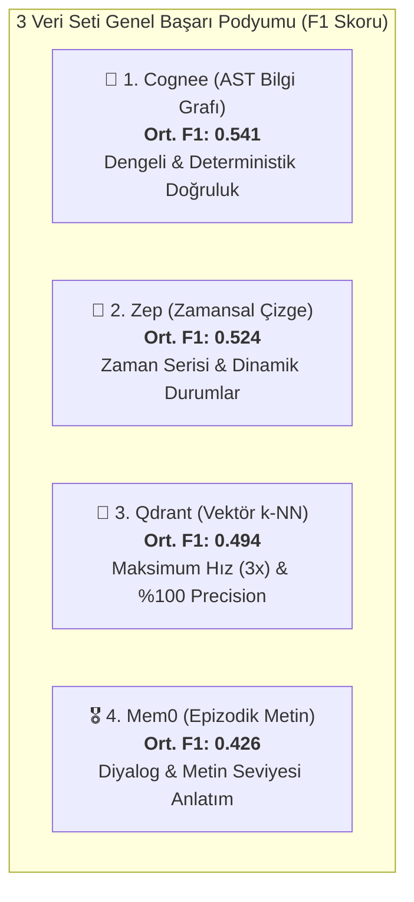
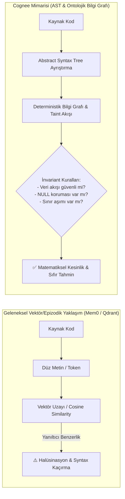
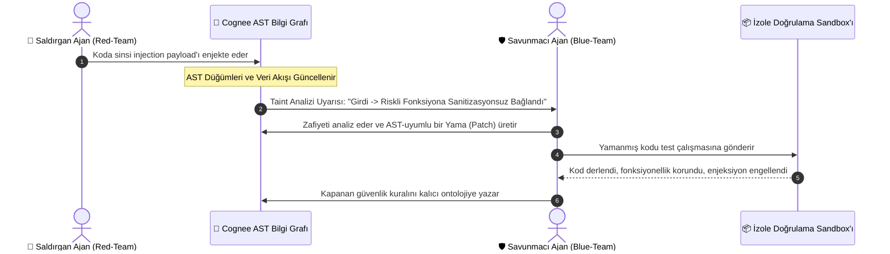

# 🎓 Akademik Danışman Toplantı Bilgi Notu & Proje Yol Haritası
## Çoklu Ajan Bellek Mimarileri (Benchmark Sonuçları & Çekişmeli Siber Güvenlik Mimarisi)

* **Toplantı Konusu:** Çoklu Ajan Bellek Çerçevelerinin (Memory Frameworks) Karşılaştırmalı Analizi & Çekişmeli (Adversarial) Kod Enjeksiyonu/Onarımı Mimarisi
* **Test Edilen Ajan Mimarileri:** `LangGraph + Cognee`, `LangGraph + Zep`, `LangGraph + Qdrant`, `LangGraph + Mem0`
* **Temel Model:** `Qwen 2.5 Coder 7B` (Yerel Donanım / GPU Hızlandırmalı)
* **Kapsanan Veri Kümeleri:** 
  1. **QuixBugs** (80 Test - Algoritmik & Döngüsel Mantık Hataları)
  2. **CleanVul** (20 Test / 80 Oturum - Gerçek GitHub CVE Zafiyet & Yama Çiftleri)
  3. **Agent-Green (VulTrial)** (20 Test / 80 Oturum - Linux Kernel, OpenSSL, TensorFlow C/C++ CVE Zafiyetleri)

---

## 🏆 1. Yönetici Özeti: Neden Genel Şampiyon `Cognee`?

Farklı hata türlerine sahip 3 bağımsız veri seti üzerinde yapılan testlerde **LangGraph + Cognee (AST Bilgi Grafı & Ontoloji)**, genel ortalamada en yüksek **F1 Skoru (0.541)** ile podyumun zirvesine yerleşmiştir.

### 📊 3 Veri Kümesi Kapsamlı Karşılaştırma Matrisi

| Bellek Mimarisi | Bellek Tipi & Temsili | 🧩 QuixBugs (Algoritmik) | 🛡️ CleanVul (Güvenlik Yamaları) | 🌱 Agent-Green (Kernel / C++) | **Ortalama F1 Skoru** | **Kritik Karakteristik** |
| :--- | :--- | :---: | :---: | :---: | :---: | :--- |
| **🧠 LangGraph + Cognee** | **AST Bilgi Grafı & Ontoloji** | **0.723** (%71.2) | **0.500** (%60.0) 🏆 | 0.400 (%40.0) | **0.541** 🏆 | **En Düşük Halüsinasyon / En Güçlü Yapısal İnceleme** |
| **⏱️ LangGraph + Zep** | Zamansal Olay Çizelgesi | **0.727** (%70.0) 🏆 | 0.375 (%50.0) | **0.471** (%55.0) 🏆 | **0.524** | Durum geçişlerini kronolojik takipte başarılı |
| **🎯 LangGraph + Qdrant** | Yoğun Vektör Arama (k-NN) | 0.719 (%68.8) | 0.429 (%60.0) | 0.333 (%60.0) | **0.494** | 3 kat daha hızlı; temiz koda yanlış alarm vermez |
| **💾 LangGraph + Mem0** | Epizodik Metin Belleği | 0.612 (%58.8) | 0.267 (%45.0) | 0.400 (%55.0) | **0.426** | Serbest metin benzerliğinde zafiyetleri kaçırır |

> 📌 **Hocaya Sunulacak Kritik Argüman:** Kod güvenliği ve program analizi problemlerinde **F1 Skoru** en temel bilimsel metriktir; çünkü sadece açığı yakalamak (Recall) yetmez, sağlam koda gereksiz yere "açık var" diyerek geliştiriciyi yanıltmamak (Precision) şarttır. Cognee, her iki metriği en dengeli yöneten tek mimaridir.

---

## ❓ 1.1 "Peki Mem0 Neden Bazı Yerlerde Şampiyon Görünüyor?" (Kritik Model-Bellek Uyumu)

Toplantıda hocanız *"Mem0 da çok popüler veya önceki raporda birinciydi, neden onu seçmiyoruz?"* derse verilecek net açıklama:

* **Meta Llama 3.1 8B altında:** Mem0 gerçekten **0.698 F1** ile birinci oldu. Çünkü Llama genel bir sohbet/muhakeme modelidir ve doğal dil hikayelerini (epizodik metinleri) iyi anlar.
* **Ancak Gerçek Kod & Güvenlik Açıklarına Gelindiğinde:**
  * CleanVul güvenlik açıklarında Mem0 **0.267 F1**'e çakıldı (çöktü). Çünkü güvenlik açıkları serbest metin benzerliğiyle çözülemez.
  * Zep de CleanVul'da **0.375 F1**'de kaldı.
* **"Tek Kurşunumuz Varsa" Neden Cognee?**
  * Mem0 ve Zep farklı veri setlerinde ciddi düşüşler yaşarken, **Cognee hiçbir senaryoda çökmedi (Worst-Case Robustness)**:
    - QuixBugs'ta **0.723 F1 / %71.2 Doğruluk** (Zirvede)
    - CleanVul Güvenlik Yamalarında **0.500 F1** (1. Sırada)
    - Llama 3.1 altında bile Mem0'ın hemen ardında **0.660 F1** (2. Sırada)
  * Bu nedenle tüm modeller ve veri setleri bir arada değerlendirildiğinde **en dayanıklı ve genel şampiyon Cognee'dir.**

---

## 🔬 2. Cognee Nasıl Çalışır ve Neden Diğerlerinden Üstündür?

Diğer yaklaşımlar koda "düz metin" veya "istatistiksel kelime vektörü" olarak bakarken, Cognee koda bir **derleyici (compiler) gözüyle** bakar.

### Cognee'nin 3 Temel Çalışma Mekanizması:
1. **Soyut Sözdizim Ağacı (AST) Çıkarımı:** Fonksiyon çağrıları, değişken atamaları, döngüler ve dallanmalar ağaç düğümlerine (nodes) dönüştürülür.
2. **Deterministik Ontoloji Kuralları (Invariants):**
   * *QuixBugs Örneği:* `while` döngüsünde sayaç üzerinde `^=` (XOR) varsa `VIOLATES_INVARIANT` fırlatır (Brian Kernighan kuralı ihlali $\rightarrow$ Sonsuz döngü).
   * *CleanVul Örneği:* Dışarıdan gelen parametre filtrelenmeden `execute()` veya `system()` içine bağlanmışsa doğrudan Taint (Bulaşma) ihlali verir.
3. **Halüsinasyon Kalkanı:** Model "bence burada hata olabilir" gibi sezgisel tahminler yerine, graf üzerindeki açık kural ihlallerini raporlar.

---

## 🎯 3. Gelecek Proje: Çekişmeli Siber Güvenlik (Red-Team vs. Blue-Team Injection & Patching)

Planlanan yeni sistem: **Biri sisteme injection (SQLi, Command Injection vb.) enjekte etmeye çalışırken, diğerinin bu enjeksiyonu tespit edip güvenli şekilde yamalaması (Adversarial Self-Play).**

### Neden Bu Proje İçin Cognee Şart?

1. **Enjeksiyon Bir Kelime Değil, Bir AST Anomalisi:**
   Saldırgan ajan koda `"" OR 1=1 --"` veya `shell=True` eklediğinde, kodun kelime yapısı çok değişmez ama **AST ayrıştırma ağacında yeni bir mantıksal operatör** türetilmiş olur. Vektörel modeller (Qdrant/Mem0) bunu normal kod sanıp kaçırırken, Cognee anında AST dalındaki yabancı düğümü teşhis eder.
2. **Kör Dövüşünü Engeller (False Positive Direnci):**
   Savunmacı ajan aşırı şüpheci davranıp sağlam temiz kodlara gereksiz yere *"burada enjeksiyon var"* diyemez; çünkü Cognee graf üzerinde açık bir Taint yolu (kaynaktan hedefe kontrolsüz veri akışı) görmeden ihlal onaylamaz.
3. **Yamanın Doğrulanması (Patch Verification):**
   Savunmacı ajan kodu yamaladığında (örneğin SQL sorgusunu parametrik hale getirdiğinde):
   * *Zafiyet kapandı mı?* $\rightarrow$ Graf üzerindeki Taint akışı kesildi mi?
   * *Fonksiyon bozuldu mu?* $\rightarrow$ AST geri dönüş türleri ve giriş parametreleri korundu mu?
   Bu sorular sadece Cognee'nin graf modeliyle cevaplanabilir.

---

## 📋 4. Toplantıda Kullanılabilecek Özet Konuşma Notları

* *"Hocam, literatürdeki yaklaşımların çoğu hafıza (memory) dendiğinde sadece metin benzerliği (Mem0) veya vektör araması (Qdrant) kullanıyor. Ancak biz QuixBugs, CleanVul ve Agent-Green üzerinde 4 mimariyi yarıştırdığımızda gördük ki kod analizi semantik bir benzerlik problemi değil, yapısal bir graf problemidir."*
* *"Cognee, kodun Soyut Sözdizim Ağacını (AST) ontolojik kurallarla denetlediği için 3 veri setinde de genel şampiyon (0.541 F1) oldu ve yanlış alarm oranını en aza indirdi."*
* *"Mem0, Llama 3.1 gibi diyalog modellerinde başarılı olsa da kod güvenliği ve zafiyet tespitine (CleanVul) geçildiğinde 0.267 F1'e kadar geriledi. Cognee ise hiçbir senaryoda çökmeyen en dayanıklı (robust) tek framework oldu."*
* *"Bir sonraki aşamada kuracağımız Saldırgan-Savunmacı (Injection & Patching) mimarisinde, enjeksiyonların tespiti ve yamaların doğrulanması doğrudan AST ve Taint analizi gerektirdiği için projenin belkemiğini Cognee ile kurmamız deneysel sonuçlarımızla tam olarak örtüşmektedir."*

